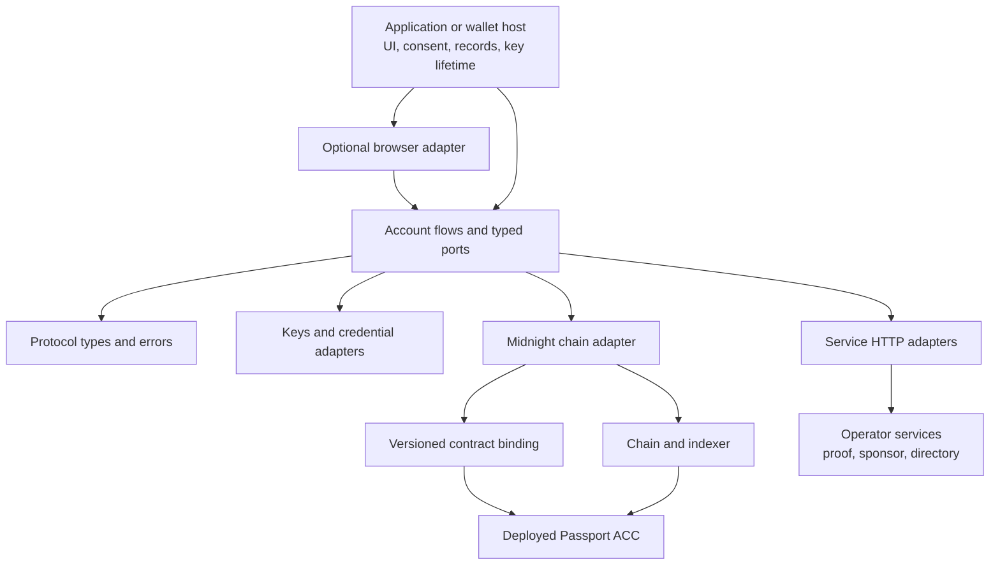

# Architecture: who owns what?

The SDK is a set of reusable account flows and adapters around a deployed Passport ACC. A host application supplies credential access, consent, persistence, and infrastructure. The ACC enforces the final on-chain authority. [Getting started](/getting-started/) shows the smaller system view.

The arrows show dependencies and calls, not private-key export. `protocol` defines shared shapes. `account` coordinates supported operations through ports. `keys` derives or handles sensitive account material from a host-owned source; `adapter-webauthn` requests a browser credential. `contract` distributes public binding artifacts; it does not contain a user's key or the full prover-key cache. `adapter-browser` is optional, and `service` is a Node library behind the reference HTTP apps.

The upstream [Passport architecture and plans](https://midnightntwrk.github.io/passport/) describe a broader product. The [upstream SDK](https://github.com/midnightntwrk/midnight-passport-sdk) is a separate codebase. This fork implements the package set documented here, and the [reference demo](/demo/) chooses one UI and service arrangement. The [standards map](/architecture/standards) distinguishes proposals, reference contract behavior, SDK exports, and deployed binding behavior.

## Follow one boundary at a time

- [Keys and wallets](/architecture/keys-wallets) separates owner, reader, viewing secret, HD wallet, sponsor, and funding wallet.
- [Package selection](/packages/) maps the nine RC8 packages to host requirements.
- [Architecture conformance](/architecture/conformance) compares this SDK with the Passport architecture's v1.0 target and current reference implementation.
- [Upstream SDK comparison](/architecture/upstream-sdk) maps this fork's implemented surfaces to the upstream SDK's latest design revision.
- [Persistence and background work](/guides/durability) explains what must survive interruption.
- [Public artifacts](/operations/artifacts) explains why proof keys have a different distribution path from private account keys.
