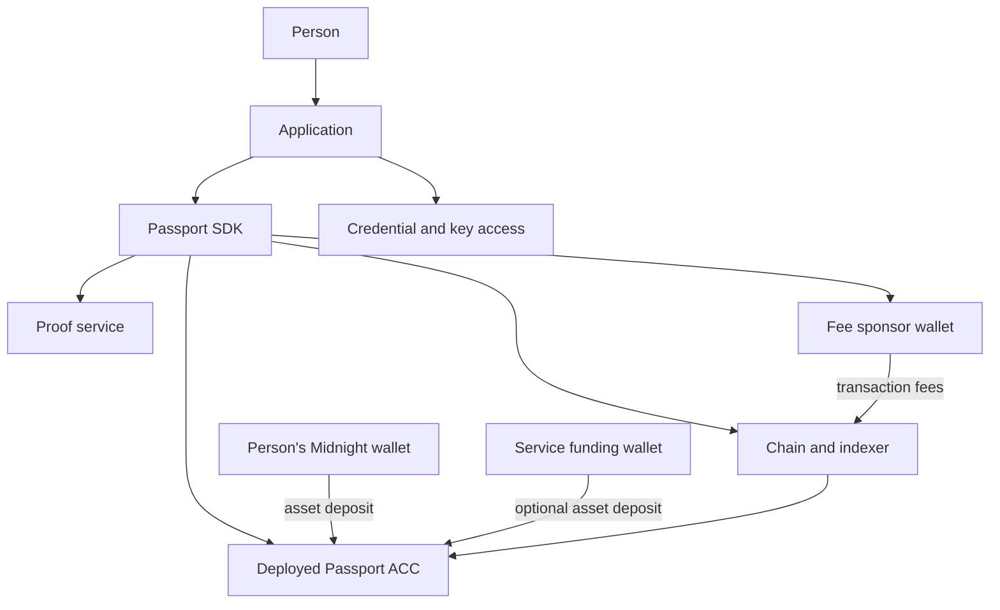
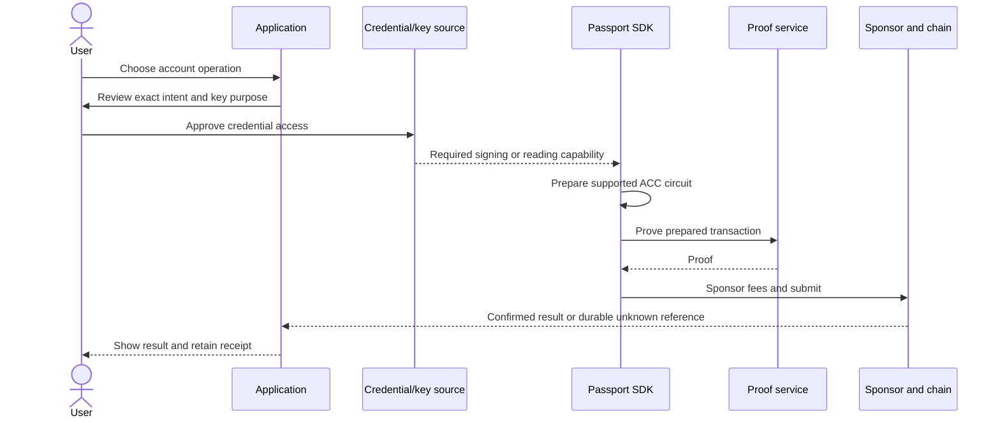

# Get started with Midnight Passport

## What is Midnight Passport?

Midnight Passport is a way to give a person an **Account Custody Contract (ACC)**: a deployed smart contract that holds assets and checks who may act for the account. A passkey can authorize supported account operations. The account can also recognize an enrolled JubJub owner key or a separately issued, bounded permission. Your application chooses the experience and supplies the wallet, credential access, storage, and network services around that contract.

The [upstream Passport project](https://github.com/midnightntwrk/passport) contains the architecture, plans, and reference ACC. This site describes the **input-output-hk SDK fork** and its published `0.1.0-rc8` packages. The [reference demo](/demo/) is a separate example host. It shows one way to assemble the libraries, local network, proving service, sponsorship wallet, and optional funding wallet.

An ACC is **not** a person's Midnight hierarchical deterministic (HD) wallet. The wallet has its own seed, address, and balance. A fee sponsor pays transaction fees; a funding wallet can deposit assets into the ACC. Neither wallet becomes the ACC's owner merely by sending funds or paying fees. [See the key and wallet model](/architecture/keys-wallets).

## What can I build today?

The current published preview is `0.1.0-rc8`, with binding `acc-s3r1.1`. These are implemented paths, subject to the listed host requirements:

| Outcome | Availability and boundary |
| --- | --- |
| Create and reopen an account | Browser P-256 passkey and PRF-derived JubJub paths are implemented. Your host must provide a compatible credential provider, persistent record, checked binding, chain, and service ports. Opening an existing account requires a known record or address **and** an enrolled credential; it does not recover a lost credential. |
| Read account state and holdings | Chain-backed account state and supported verified holdings reads are implemented. Private holdings require the appropriate reader and viewing secret. A connected HD wallet balance is separate. |
| Deposit assets and withdraw | The ACC binding supports deposits and owner or bounded-grant withdrawals. A deposit needs an asset-holding wallet or funded service. Unshielded withdrawal needs a value-capable call path; the fee sponsor only pays fees. Shielded withdrawal currently refuses partial spends and requires an exact-value coin. |
| Manage devices and keys | Enrollment, rotation, and removal are implemented for supported owner arms. These operations require complete live device, grant, and holding sources; missing information must cause refusal. |
| Issue bounded permissions | Supported grants pin recipient, asset, caps, expiry, and other scope. A grant signer is not a full owner. The host must preserve openings and reconcile uncertain issuance or revocation. Arbitrary ACC-to-contract calls are not claimed. |
| Integrate another wallet or host | The `account` package accepts typed ports; browser and service adapters are optional. Lace-style host evaluation exists, but full Lace/provider interoperability is not established by the release. |
| Distribute contract and proof artifacts | The contract package ships the pinned binding, ZKIR, and verifier material. Public prover keys are restored separately and can be served by the key service. These artifacts are not private account keys. |
| Operate services | Separate reference applications provide proving/chain access, fee sponsorship, and wallet-backed funding. They require operator configuration, protected ingress, state, and wallets. An npm install starts none of them. |

The [capability map](/packages/api) names the relevant public operations and optional ports. [Release notes](https://github.com/input-output-hk/midnight-passport-sdk/releases/tag/sdk-v0.1.0-rc8) and [qualification limits](/operations/quality) distinguish published behavior, source work, and tested environments.

## How does an operation work?

The application owns the user action and consent. The SDK calls host-supplied credential, chain, and service capabilities. The ACC enforces on-chain authority. The person's wallet and service funding wallet move **assets** into the ACC; the sponsor wallet contributes **fees** to eligible transactions. Private keys and passkey outputs stay in the credential/key boundary chosen by the host. A proof service sees the witness data required to prove an operation, so choose and protect it as a trusted service.

The application must obtain consent for the **actual** action; authentication alone is not transfer approval. On-chain authority comes from an enrolled owner key or a live grant. A local session timeout stops local use but does not revoke that authority. If submission is uncertain, retain the original IDs and reconcile before retrying. [Read the trust boundaries](/architecture/keys-wallets).

## Choose your path

| Your path | Prerequisites | Minimum relevant packages or components | Outcome and next guide |
| --- | --- | --- | --- |
| Browser application | HTTPS or localhost, supported passkey/PRF provider, persistent records, checked network and service endpoints | `adapter-browser`, `adapter-service`, `contract`; `account/ports` and `protocol` for types | Create/open a P-256 ACC. [First browser integration](/getting-started/first-integration). |
| Node or existing wallet host | Host signer/credential capability, consent, chain/prover/value ports, durable state | `account`, `protocol`, `contract`; select `keys` and transport adapters as needed | Reuse the account flows behind your host's ports. [Host integration](/guides/hosts). |
| Reference demo | Nix, Docker/localnet resources, browser passkey, pinned local configuration | Demo app plus three separate service apps; SDK packages are workspace dependencies | Try guided scenarios. [Run the demo](/demo/). |
| Backend operator | Chain/indexer, key cache, proof backend, sponsor and optional funding wallets, protected state | `service`, `contract`, service applications/images | Prove and submit supported calls. [Operate services](/operations/). |
| Contract/artifact adopter | Compatible Compact/Midnight runtime and an independently pinned binding | `contract`, optionally `contract/capabilities` | Build an application-contract → deployed ACC call path. [Contract layer](/operations/artifacts). |

## Your next step

Start with the [complete first browser integration](/getting-started/first-integration), or [choose packages](/packages/) for a different host. The [glossary](/architecture/glossary) explains terms used throughout the site.
