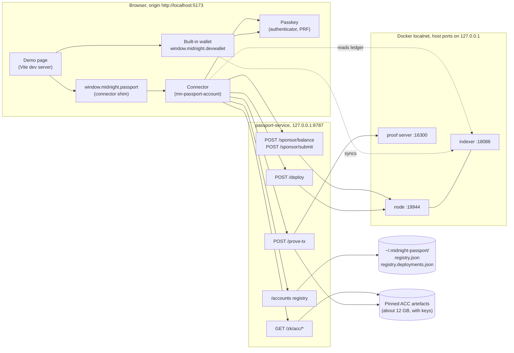

# Midnight Passport DApp prototype

## Approved UX implementation milestone

See the [execution map](ux-milestone.md) for the current local naming/interaction
slice, responsive shell/Settings/Audit implementation and pending optional host wiring.
Read the [workspace guide](../site/demo-ui.md) for the current action locations.
These source additions are not in published RC7. Existing launch and safety rules
in this guide remain in force.

The local source after RC7 also has a read-only, app-owned mock naming adapter.
See [naming-service interfaces, replacement and demo limits](../site/names.md).
It is independent of onboarding and never authorizes or redirects a transfer.

For the current `acc-s3r1.1` setup, funding flow, audit status and operator handover, see the
[engineering handover](../site/handover.md). The run evidence below is historical and names the
older `acc-45721e1` binding.

For the current available flows, follow the [demo use cases](../site/use-cases.md)
and [click-through guide](demo.md). The use-case catalogue distinguishes available demo controls
from completed real-provider qualification.

The standalone service exposes `POST /v1/prove-tx` and `POST /v1/deploy` as request-and-poll jobs (`GET /v1/jobs/{id}`), plus `/v1/sponsor/balance`, `/v1/sponsor/submit`, `/v1/config`, and verified `/v1/zk/{bindingId}` artefacts. The browser uses these versioned routes. The legacy routes remain for older clients; both route sets share the same serial proof/deploy queue and deployment cap.

This is a working prototype of the Passport **account API** and the web app that carries its heavy
lifting. The prototype called the account API the "DApp Connector API"; every operation in it is the
account owner's, so it is now the account API v1 (ADR 0007, D-8), and the dApp-facing connection is
the later grant ceremony. It serves Lace epic LW-15579 (the Passport smart account as the Lace account model)
and unblocks LW-15635 (a passkey Passport account) **on the standalone network**.

A new user creates a passkey. The browser deploys a Passport account (the ACC), pays the fees,
installs the passkey as the first device and publishes a random viewing secret sealed to that
device's PRF-derived reader. After a page reload the same passkey can reopen its envelope against
the live ACC key. The built-in Midnight wallet is derived separately from the passkey.

The account API v1 is versioned in `mn-passport-protocol` (`1.0.0-pre.0`); the prototype's
`0.1.0-prototype` shapes remain as deprecated `…Prototype` types behind `createPassportConnector`. The design is in
[`docs/superpowers/specs/2026-10-06-passport-dapp-design.md`](../superpowers/specs/2026-10-06-passport-dapp-design.md).
This folder describes what the code does today.

The CLI can start the browser with `pnpm demo up --arm jubjub --mock-passkey`.
P-256 remains the default. Both browser arms now create a random viewing secret and sealed
reader envelope. The page offers reviewed sealed-key rotation using chain-backed devices,
holdings and read-grant targets; it refuses an incomplete reader/grantee roster. The old localnet run results below used the deterministic-key
P-256 prototype and are historical evidence, not a validation of this sealed P-256 flow.

## Historical deterministic-key localnet runs

Everything below ran on the Passport localnet, network id `undeployed`, against the pinned
artefacts (binding `acc-45721e1`).

| Capability                                                                              | Evidence                                                                                            |
| --------------------------------------------------------------------------------------- | --------------------------------------------------------------------------------------------------- |
| Create an account: passkey, 10-wave deploy, sponsored activation                        | Deploy 180 s, activation 24 s, about 3 min 24 s in all (X8: 179.6 s and 24.0 s; X9: 180 s and 24 s) |
| Rotate the encryption key with a passkey signature, proved on the service and sponsored | About 1 min per rotation (X8: 72 s and 53 s; X9: the proof itself took 22.5 s)                      |
| Reopen the account with the same passkey after a reload, checked against the chain      | Under a second once the passkey answers (X8: 38 ms for the checks)                                  |
| Rotate again after the reopen, which rescans the use counter                            | Confirmed, authorisation nonce 2 (X8, X9, X9a)                                                      |
| Connect the built-in wallet, derived from the passkey, over DApp Connector API 4.1.0    | Connected and synced against the indexer from the page (X9, X9a)                                    |
| Refuse a passkey provider without PRF before anything is deployed                       | Seen in X9 with the "Chrome profile" store                                                          |
| The whole flow with a software authenticator, without a browser                         | X8 passed in 329 s: create, rotate, reopen, rotate                                                  |
| The whole flow in a browser with a mock passkey                                         | X9a                                                                                                 |
| The whole flow in Chrome on macOS with a platform passkey that has PRF                  | X9                                                                                                  |

The run records are in `experiments/acc-0.35/results/`:
[`x8-dapp-e2e.json`](../../experiments/acc-0.35/results/x8-dapp-e2e.json),
[`x9-dapp-mock-run.md`](../../experiments/acc-0.35/results/x9-dapp-mock-run.md) and
[`x9-dapp-manual-run.md`](../../experiments/acc-0.35/results/x9-dapp-manual-run.md).

The longest wait is the deploy. The ACC does not fit in one block, so the service deploys it in 10
waves. The demo asks for the maintenance authority to be retired (`retireAuthority: true`), which
the last wave does, so a deployed account can never be upgraded. The account API makes the caller
choose; there is no default.

What does not work, or is not built, is in [limitations.md](./limitations.md). The main points: the
registry is an off-chain file, the testnet is not wired, and the service has no authentication.

## Components

- **The page** (`apps/passport-dapp`) injects the connector at `window.midnight.passport`, as a
  wallet would, and drives it by its buttons. It also hosts the built-in wallet.
- **The connector** (`packages/account`) holds the flows: create, open and rotate. It reaches the
  passkey, the chain and the registry only through injected seams.
- **The browser composition** (`packages/adapter-browser`) wires the WebAuthn and key-recipe
  adapters to service ports and lazy-loads `adapter-midnight-js` for chain calls. The old service
  chain remains under its `./prototype` export for the e2e harness.
- **The service** (`apps/passport-service`) serves the ZK artefacts, proves transactions, deploys
  accounts, sponsors fees and keeps the registry. It holds the only funded key.
- **The localnet** (`infra/localnet`) is a node, an indexer and a proof server in Docker. The
  service talks to all three. The page talks to the indexer only.

## Processes and ports

| Port  | Process                       | Why this port                                                                                                                                                      |
| ----- | ----------------------------- | ------------------------------------------------------------------------------------------------------------------------------------------------------------------ |
| 5173  | The demo page (Vite)          | Fixed, with `strictPort`. The ACC's WebAuthn profile `wa-json134` binds a 21-byte origin, and `http://localhost:5173` is exactly 21 bytes. Open it as `localhost`. |
| 8787  | `passport-service`            | The service's default (`PASSPORT_SERVICE_PORT`). The page expects it unless `VITE_PASSPORT_SERVICE_URL` says otherwise. Bound to `127.0.0.1`.                      |
| 19944 | Node (container 9944)         | Host port of the Passport localnet. It differs from the Midnight default 9944.                                                                                     |
| 18088 | Indexer (container 8088)      | As above. The Midnight default is 8088.                                                                                                                            |
| 16300 | Proof server (container 6300) | As above. The Midnight default is 6300.                                                                                                                            |

The localnet ports are non-default so that the stack runs beside another Midnight localnet on the
same machine. Inside the Docker network the containers keep their standard ports. On macOS the
compose override publishes the host ports on `127.0.0.1` only. They are set in
[`infra/localnet/ports.env`](../../infra/localnet/ports.env), which `scripts/prototype-up.sh`, the
compose override and the service all read. `experiments/acc-0.35/patch-endpoints.sh` rewrites the
reference client's hard-coded 9944, 8088 and 6300 to follow the same file.

`pnpm prototype:up` checks that all five ports are free and exits, naming the occupant, if one is
not. It never stops anything for you.

## Where state lives

| State                                           | Where                                            | Notes                                                                                                                                       |
| ----------------------------------------------- | ------------------------------------------------ | ------------------------------------------------------------------------------------------------------------------------------------------- |
| The account: devices, nonce, encryption key     | The chain (the localnet's Docker volumes)        | The authority. `prototype:up` stops the containers and keeps the volumes, so accounts survive a restart.                                    |
| Passkey to account mapping                      | `~/.midnight-passport/registry.json`             | Written by the service. Keyed `<networkId>/<credentialId>`. An untrusted hint: the connector checks it against the chain before it uses it. |
| Accounts this service deployed                  | `~/.midnight-passport/registry.deployments.json` | Beside the registry. The sponsor funds calls only to accounts that are in both files.                                                       |
| The passkey's private key                       | The authenticator                                | It never leaves it.                                                                                                                         |
| Wallet seed, account encryption key, PRF output | Nowhere                                          | Derived on demand and zeroed. See [keys.md](./keys.md).                                                                                     |
| Browser storage                                 | None                                             | The one exception is the dev-only mock passkey, which keeps its keys in `localStorage` (`passport-dev:mock-passkey:v1`).                    |
| The evidence panel                              | The page, in memory                              | Lost on reload. Use "Copy evidence" first.                                                                                                  |

`PASSPORT_REGISTRY_FILE` moves the registry. The deployed set follows it. The files are kept outside
the repository so that accounts can be reopened later. After a chain reset, delete both. See
[demo.md](./demo.md#troubleshooting).

## The other documents

- [demo.md](./demo.md): the demo script for a presenter, mock mode, passkey provider advice and
  troubleshooting.
- [flows.md](./flows.md): a sequence diagram for each flow, with the endpoints, circuits and seams.
- [keys.md](./keys.md): how the wallet seed and the account's encryption key derive from the
  passkey.
- [limitations.md](./limitations.md): what the prototype does not do, and what production needs.
- [`apps/README.md`](../../apps/README.md): setup, environment variables, how to run the stack, and
  operational troubleshooting. This folder does not repeat it.

### Local interruption-safety work

[Mutation durability and grant recovery](../site/durability.md) describes the opt-in
protected owner coordinator and demo published-bookkeeping fallback. Default owner
buttons still require reconciliation after an interruption. Keep the original
reader/journal: another enrolled reader cannot invent missing grant openings.

The [public signer qualification lane](../site/consumer-integration.md#public-source-signer-handlers)
checks the installed RC6 client against separately pinned public upstream handlers. Its
simulated-window protocol probe is distinct from native SDK add-device qualification and real
passkey-provider acceptance. Authorising-only enrollment transfers no viewing secret; unsupported
hosted consent kinds remain refused. The default demo flow is unchanged.

The next source candidate adds journalled shielded deposit continuation for library hosts. It
preserves original ciphertext and never automatically replays an unknown dispatch; it does not
add a shielded deposit button or endpoint to the demo. See the [engineer recovery contract](../site/shielded-deposit-recovery.md).

The shared HTTP boundary now rejects empty fragments and normalised authority-like paths, emits
only generic unexpected-error responses, and supports an explicit redacted route-failure callback.
A streaming failure closes the response; it never proves an uncertain transaction was not sent.

The optional shared HTTP `onRouteError` callback accepts synchronous or asynchronous telemetry.
Neither throws, rejections nor stalled telemetry change/delay the public response. The public
signer browser qualification also documents a pinned-host navigation limitation: an old-port
request can remain pending until close; fresh-client consent does not replay it. See the
[consumer boundary](../site/consumer-integration.md#browser-navigation-and-reconnect-boundary).

## Source increment after RC7: consented sessions

The demo now offers an opt-in 10–30 minute (default 15) PRF-derived JubJub child
with an owner-approved fixed-recipient/asset, capped, expiring grant. Matching
unshielded withdrawals use transfer consent without another passkey; critical
owner actions keep fresh passkey paths. Local lock, hiding the tab and reload
dispose the signer, not its chain grant. Unknown effects retain a public reload
fence. See [the session guide](../site/jubjub-sessions.md) for the setup,
derivation and qualification limits. This is local source work, absent from
published RC7; no new full Lace/provider/native qualification is claimed.

The session source increment coordinates authenticated/value actions across
same-profile tabs using browser Web Locks. Missing coordination refuses new
mutations. Public per-intent issue/spend/revocation records survive stale-tab
metadata writes and reloads; confirmed records prevent stale uncertainty revival.
This does not coordinate separate browsers/devices or replace host durable jobs.

The [native session qualification map](../review/native-sessions/README.md) describes
an isolated opt-in lane for the consented JubJub source increment. Both synthetic
owner arms use the actual controller/SDK and a fresh faucet token. Native proof,
browser consent, real-provider and published-artifact acceptance are separate.

The post-RC7 session lane passes at signed `b5eeff8` for both software owner
arms. See the [exact native source receipt](../review/native-sessions/README.md).
It includes real ten-minute expiry, original-hash observer recovery and cleanup;
NIGHT, browser/provider and published-artifact claims keep their separate evidence.

## Overview layout (source preview)

Settings now uses separate Devices & passkeys / Quick actions / Permissions /
Wallet connections / Developer tools submenu pages. [Quick actions](../site/quick-actions.md)
provides an explicitly consented, bounded PRF unlock for routine reads and built-in
wallet connection. Scoped JubJub transfers still require a separately approved
grant; critical owner actions keep fresh passkey approval. No secret persists
across reload or local lock, and unknown intents retain their original fences.

Desktop navigation keeps all section groups visible in a stable, independently
scrolling rail. Wallet has Built-in wallet and Lace Wallet pages; Audit has Event
log, Requests & responses and Export JSON. Compact screens use a modal Menu
drawer, with the same controls and no layout shift. Read the
[UI guide](../site/demo-ui.md) for routes and keyboard behavior.

Overview offers one compact **Your Passport account** panel with **Open with
passkey** as the primary action and **Create account** as secondary. Below them,
**Have an account address?** reveals the advanced
address-based opening flow. The address still requires an enrolled passkey; it
is not account recovery. Navigation/disclosure changes preserve the address draft
and start no credential or transaction. Activity starts collapsed with its trigger
beside the workspace title; approved credential requests reveal their explanation
before access and retain their separate blocking consent dialog.

## Authenticated owner policy update (local source)

The owner approved full use of the deterministic Lace PRF-1 JubJub owner while
explicitly authenticated. **Settings → Quick actions → Unlock account** verifies an
existing JubJub owner or explicitly enrolls a P-256 companion once. All implemented
owner operations, including device/key/permission changes, then use that key without
fresh passkey requests; exact action reviews remain. This supersedes the earlier
critical-operation step-up rule for this mode only. **Unlock reading only** preserves
the restricted cache/grant alternative. Local expiry clears memory, not the durable
chain owner. Read [the full authority/lifetime guide](../site/authenticated-owner.md).
No new native/provider/full Lace qualification or published package change is implied.
