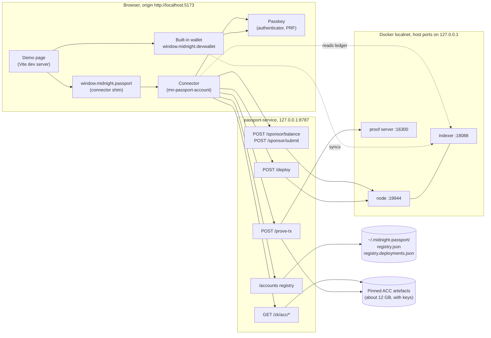

# Midnight Passport DApp prototype

This folder documents the reference app and its historical qualification records.
Reusable package installation/contracts live in the [library guide](../site/library-guide.md)
and [runtime/export index](../site/packages.md#runtime-and-host-requirements).
The [demo guide](../site/demo-guide.md) describes current host policy and composition.
Later source-preview APIs are not part of published RC7; dated runs retain their
original binding, source and provider limits.

## Approved UX implementation milestone

See the [execution map](ux-milestone.md) for the current local naming/interaction
slice, responsive shell/Settings/Audit implementation and pending optional host wiring.
Read the [workspace guide](../site/demo-ui.md) for the current action locations.
These source additions are not in published RC7. Existing launch and safety rules
in this guide remain in force.

The local source after RC7 also has a read-only, app-owned mock naming adapter.
See [naming-service interfaces, replacement and demo limits](../site/names.md).
It is independent of onboarding and never authorizes or redirects a transfer.

For the current `acc-s3r1.1` setup, funding flow, audit status and operator handover, see the
[engineering handover](../site/handover.md). The run evidence below is historical and names the
older `acc-45721e1` binding.

For the current available flows, follow the [demo use cases](../site/use-cases.md)
and [click-through guide](demo.md). The use-case catalogue distinguishes available demo controls
from completed real-provider qualification.

The standalone service exposes `POST /v1/prove-tx` and `POST /v1/deploy` as request-and-poll jobs (`GET /v1/jobs/{id}`), plus `/v1/sponsor/balance`, `/v1/sponsor/submit`, `/v1/config`, and verified `/v1/zk/{bindingId}` artefacts. The browser uses these versioned routes. The legacy routes remain for older clients; both route sets share the same serial proof/deploy queue and deployment cap.

This is a working prototype of the Passport **account API** and the web app that carries its heavy
lifting. The prototype called the account API the "DApp Connector API"; every operation in it is the
account owner's, so it is now the account API v1 (ADR 0007, D-8), and the dApp-facing connection is
the later grant ceremony. It serves Lace epic LW-15579 (the Passport smart account as the Lace account model)
and unblocks LW-15635 (a passkey Passport account) **on the standalone network**.

A new user creates a passkey. The browser requests a sponsored Passport account (ACC)
deployment; the service pays fees. The flow installs the passkey as the first device and publishes a random viewing secret sealed to that
device's PRF-derived reader. After a page reload the same passkey can reopen its envelope against
the live ACC key. The built-in Midnight wallet is derived separately from the passkey.

The account API v1 is versioned in `mn-passport-protocol` (`1.0.0-pre.0`); the prototype's
`0.1.0-prototype` shapes remain as deprecated `…Prototype` types behind `createPassportConnector`. The design is in
[`docs/superpowers/specs/2026-10-06-passport-dapp-design.md`](../superpowers/specs/2026-10-06-passport-dapp-design.md).
Current sections describe the supported source composition; explicitly historical
sections retain earlier designs and evidence without relabeling them as current.

The CLI can start the browser with `pnpm demo up --arm jubjub --mock-passkey`.
P-256 remains the default. Both browser arms now create a random viewing secret and sealed
reader envelope. The page offers reviewed sealed-key rotation using chain-backed devices,
holdings and read-grant targets; it refuses an incomplete reader/grantee roster. The old localnet run results below used the deterministic-key
P-256 prototype and are historical evidence, not a validation of this sealed P-256 flow.

## Historical deterministic-key localnet runs

Everything below ran on the Passport localnet, network id `undeployed`, against the pinned
artefacts (binding `acc-45721e1`).

| Capability                                                                              | Evidence                                                                                            |
| --------------------------------------------------------------------------------------- | --------------------------------------------------------------------------------------------------- |
| Create an account: passkey, 10-wave deploy, sponsored activation                        | Deploy 180 s, activation 24 s, about 3 min 24 s in all (X8: 179.6 s and 24.0 s; X9: 180 s and 24 s) |
| Rotate the encryption key with a passkey signature, proved on the service and sponsored | About 1 min per rotation (X8: 72 s and 53 s; X9: the proof itself took 22.5 s)                      |
| Reopen the account with the same passkey after a reload, checked against the chain      | Under a second once the passkey answers (X8: 38 ms for the checks)                                  |
| Rotate again after the reopen, which rescans the use counter                            | Confirmed, authorisation nonce 2 (X8, X9, X9a)                                                      |
| Connect the built-in wallet, derived from the passkey, over DApp Connector API 4.1.0    | Connected and synced against the indexer from the page (X9, X9a)                                    |
| Refuse a passkey provider without PRF before anything is deployed                       | Seen in X9 with the "Chrome profile" store                                                          |
| The whole flow with a software authenticator, without a browser                         | X8 passed in 329 s: create, rotate, reopen, rotate                                                  |
| The whole flow in a browser with a mock passkey                                         | X9a                                                                                                 |
| The whole flow in Chrome on macOS with a platform passkey that has PRF                  | X9                                                                                                  |

The run records are in `experiments/acc-0.35/results/`:
[`x8-dapp-e2e.json`](../../experiments/acc-0.35/results/x8-dapp-e2e.json),
[`x9-dapp-mock-run.md`](../../experiments/acc-0.35/results/x9-dapp-mock-run.md) and
[`x9-dapp-manual-run.md`](../../experiments/acc-0.35/results/x9-dapp-manual-run.md).

The longest wait is the deploy. The ACC does not fit in one block, so the service deploys it in 10
waves. The demo asks for the maintenance authority to be retired (`retireAuthority: true`), which
the last wave does, so a deployed account can never be upgraded. The account API makes the caller
choose; there is no default.

What does not work, or is not built, is in [limitations.md](./limitations.md). The main points: the
registry is an off-chain file, the testnet is not wired, and the default public
proof/sponsor routes have no caller authentication. Opt-in authenticated
host-job/mutation routes are separate compositions.

## Components

The diagram preserves the original prototype's legacy route/component view. Current
source uses versioned service routes, the split library adapters, and an owned wallet
Worker. The page owns credential review; neither importing the SDK nor navigating
the demo starts a credential, worker or wallet. See the current
[composition guide](../site/demo-guide.md#built-in-wallet-worker).

- **The page** (`apps/passport-dapp`) injects the connector at `window.midnight.passport`, as a
  wallet would, and drives it by its buttons. It also hosts the built-in wallet.
- **The connector** (`packages/account`) holds the flows: create, open and rotate. It reaches the
  passkey, the chain and the registry only through injected seams.
- **The browser composition** (`packages/adapter-browser`) wires the WebAuthn and key-recipe
  adapters to service ports and lazy-loads `adapter-midnight-js` for chain calls. The old service
  chain remains under its `./prototype` export for the e2e harness.
- **The service** (`apps/passport-service`) serves the ZK artefacts, proves transactions, deploys
  accounts, sponsors fees and keeps the registry. It owns the fee sponsor; the optional funding process and user wallet have separate keys.
- **The localnet** (`infra/localnet`) is a node, an indexer and a proof server in Docker. The
  service talks to all three. The page talks to the indexer only.

## Processes and ports

| Port  | Process                       | Why this port                                                                                                                                                      |
| ----- | ----------------------------- | ------------------------------------------------------------------------------------------------------------------------------------------------------------------ |
| 5173  | The demo page (Vite)          | Fixed, with `strictPort`. The ACC's WebAuthn profile `wa-json134` binds a 21-byte origin, and `http://localhost:5173` is exactly 21 bytes. Open it as `localhost`. |
| 8787  | `passport-service`            | The service's default (`PASSPORT_SERVICE_PORT`). The page expects it unless `VITE_PASSPORT_SERVICE_URL` says otherwise. Bound to `127.0.0.1`.                      |
| 19944 | Node (container 9944)         | Host port of the Passport localnet. It differs from the Midnight default 9944.                                                                                     |
| 18088 | Indexer (container 8088)      | As above. The Midnight default is 8088.                                                                                                                            |
| 16300 | Proof server (container 6300) | As above. The Midnight default is 6300.                                                                                                                            |

The localnet ports are non-default so that the stack runs beside another Midnight localnet on the
same machine. Inside the Docker network the containers keep their standard ports. On macOS the
compose override publishes the host ports on `127.0.0.1` only. They are set in
[`infra/localnet/ports.env`](../../infra/localnet/ports.env), which `scripts/prototype-up.sh`, the
compose override and the service all read. `experiments/acc-0.35/patch-endpoints.sh` rewrites the
reference client's hard-coded 9944, 8088 and 6300 to follow the same file.

`pnpm prototype:up` checks that all five ports are free and exits, naming the occupant, if one is
not. It never stops anything for you.

## Where state lives

| State                                           | Where                                            | Notes                                                                                                                                       |
| ----------------------------------------------- | ------------------------------------------------ | ------------------------------------------------------------------------------------------------------------------------------------------- |
| The account: devices, nonce, encryption key     | The chain (the localnet's Docker volumes)        | The authority. `prototype:up` stops the containers and keeps the volumes, so accounts survive a restart.                                    |
| Passkey to account mapping | `~/.midnight-passport/registry.json.v1`; legacy `registry.json` lookup | Untrusted service hints. The connector verifies the live ACC and sealed reader before use. |
| Accounts this service deployed | `~/.midnight-passport/registry.deployments.json` | Durable deployment allowlist used by the sponsor policy, separate from the user wallet and account authority. |
| The passkey's private key                       | The authenticator                                | It never leaves it.                                                                                                                         |
| Wallet seed, account viewing secret, PRF output | Distinct operation/cache/wallet scopes | Raw PRF output is scoped; the random viewing secret is sealed on chain. Explicit routine access retains derived material in memory; a running wallet owns separate state. See [keys.md](./keys.md). |
| Browser storage | Host-owned account records and encrypted recovery/grant journals | Durable metadata and unknown intent IDs survive reload. No automatic private-key restoration. The dev-only mock credential has its own test-only storage. |
| Activity and Audit | The page, in memory, plus durable operation journals | Export public traces before reload; a disappearing UI trace does not clear a durable unknown operation. |

`PASSPORT_REGISTRY_FILE` moves the registry. The deployed set follows it. The files are kept outside
the repository so that accounts can be reopened later. An intentional chain reset requires
archiving and reconciling the old hints and transaction evidence before selecting fresh state.
Never delete journals or unknown IDs to repair an ordinary restart or failed open. See
[demo.md](./demo.md#troubleshooting).

## The other documents

- [demo.md](./demo.md): the demo script for a presenter, mock mode, passkey provider advice and
  troubleshooting.
- [flows.md](./flows.md): a sequence diagram for each flow, with the endpoints, circuits and seams.
- [keys.md](./keys.md): how the wallet seed and the account's encryption key derive from the
  passkey.
- [limitations.md](./limitations.md): what the prototype does not do, and what production needs.
- [`apps/README.md`](../../apps/README.md): setup, environment variables, how to run the stack, and
  operational troubleshooting. This folder does not repeat it.

### Local interruption-safety work

[Mutation durability and grant recovery](../site/durability.md) describes the opt-in
protected owner coordinator and demo published-bookkeeping fallback. Default owner
buttons still require reconciliation after an interruption. Keep the original
reader/journal: another enrolled reader cannot invent missing grant openings.

The [public signer qualification lane](../site/consumer-integration.md#public-source-signer-handlers)
checks the installed RC6 client against separately pinned public upstream handlers. Its
simulated-window protocol probe is distinct from native SDK add-device qualification and real
passkey-provider acceptance. Authorising-only enrollment transfers no viewing secret; unsupported
hosted consent kinds remain refused. The default demo flow is unchanged.

The next source candidate adds journalled shielded deposit continuation for library hosts. It
preserves original ciphertext and never automatically replays an unknown dispatch; it does not
add a shielded deposit button or endpoint to the demo. See the [engineer recovery contract](../site/shielded-deposit-recovery.md).

The shared HTTP boundary now rejects empty fragments and normalised authority-like paths, emits
only generic unexpected-error responses, and supports an explicit redacted route-failure callback.
A streaming failure closes the response; it never proves an uncertain transaction was not sent.

The optional shared HTTP `onRouteError` callback accepts synchronous or asynchronous telemetry.
Neither throws, rejections nor stalled telemetry change/delay the public response. The public
signer browser qualification also documents a pinned-host navigation limitation: an old-port
request can remain pending until close; fresh-client consent does not replay it. See the
[consumer boundary](../site/consumer-integration.md#browser-navigation-and-reconnect-boundary).

## Source increment after RC7: consented sessions

The demo now offers an opt-in 10–30 minute (default 15) PRF-derived JubJub child
with an owner-approved fixed-recipient/asset, capped, expiring grant. Matching
unshielded withdrawals use transfer consent without another passkey; critical
owner actions keep fresh passkey paths. Local lock, hiding the tab and reload
dispose the signer, not its chain grant. Unknown effects retain a public reload
fence. See [the session guide](../site/jubjub-sessions.md) for the setup,
derivation and qualification limits. This is local source work, absent from
published RC7; no new full Lace/provider/native qualification is claimed.

The session source increment coordinates authenticated/value actions across
same-profile tabs using browser Web Locks. Missing coordination refuses new
mutations. Public per-intent issue/spend/revocation records survive stale-tab
metadata writes and reloads; confirmed records prevent stale uncertainty revival.
This does not coordinate separate browsers/devices or replace host durable jobs.

The [native session qualification map](../review/native-sessions/README.md) describes
an isolated opt-in lane for the consented JubJub source increment. Both synthetic
owner arms use the actual controller/SDK and a fresh faucet token. Native proof,
browser consent, real-provider and published-artifact acceptance are separate.

The post-RC7 session lane passes at signed `b5eeff8` for both software owner
arms. See the [exact native source receipt](../review/native-sessions/README.md).
It includes real ten-minute expiry, original-hash observer recovery and cleanup;
NIGHT, browser/provider and published-artifact claims keep their separate evidence.

## Entry and workspace layout (source preview)

Settings now uses separate Devices & passkeys / Quick actions / Permissions /
Wallet connections / Developer tools submenu pages. [Quick actions](../site/quick-actions.md)
provides an explicitly consented, bounded PRF unlock for routine reads and built-in
wallet connection. Scoped JubJub transfers still require a separately approved
grant; critical owner actions keep fresh passkey approval. No secret persists
across reload or local lock, and unknown intents retain their original fences.

Desktop navigation keeps all section groups visible in a stable, independently
scrolling rail. Wallet has Built-in wallet and Lace Wallet pages; Audit has Event
log, Requests & responses and Export JSON. Compact screens use a modal Menu
drawer, with the same controls and no layout shift. Read the
[UI guide](../site/demo-ui.md) for routes and keyboard behavior.

The signed-out entry offers **Sign up / Log in**, with **Log in with an account
address** as the secondary address-based opening flow. Overview is not a menu
item. The brand Home link opens Account balances after verified opening; it does
not log out, request a passkey or reset account state. The address still requires an enrolled passkey; it
is not account recovery. Navigation/disclosure changes preserve the address draft
and start no credential or transaction. Activity starts collapsed with its trigger
beside the workspace title; approved credential requests reveal their explanation
before access and retain their separate blocking consent dialog.

## Authenticated owner policy update (local source)

Current policy requires passkey login and fresh approval for critical owner
operations, even while a deterministic Lace PRF-1 JubJub owner is unlocked.
**Settings → Quick actions → Unlock account** verifies an existing owner or
explicitly enrolls a P-256 companion; that key still has durable FULL on-chain
authority. Fresh host approval matches owner and reader to the captured lease,
without extending it. Routine holdings/wallet access reuses the approved lease;
transfers within a separately approved recipient/asset/caps/expiry use their scoped
JubJub grant. Outside that scope, a fresh owner passkey is required. Local lock is
not chain revocation. Read [the authority/lifetime guide](../site/authenticated-owner.md).
No new provider/native/full Lace or publication claim is implied.

## Source quality and execution boundaries

The [quality strategy](../site/quality.md) specifies the package coverage gate,
web/Node contracts and worker test scope. The demo's built-in wallet now runs in
an owned browser worker; credential consent stays on the page. Secret persistence
is optional and does not change the existing memory-only owner authentication.
See [the secret-store design](../adr/0016-host-secret-custody.md).

NIGHT and DUST now have independent readiness and presentation. DUST runs as an
observed background read; a pending/failing DUST sync does not hold a ready NIGHT
balance or wallet action open. Refresh/reconnect revisions discard late results.

## Exact review and P-256 withdrawal follow-up (source preview)

A known owner withdrawal or grant-opening export now combines its exact decision
with the first actual derive/sign ceremony review. The demo captures the selected
account and actual signer, then rechecks that route and the exact transfer or grant
ID before value dispatch or opening display. Navigation, mutation, expiry or a
declined review refuses new effects without a fallback signer. Matching bounded
grant transfers retain a standalone exact decision because they use no new
credential call. Already dispatched receipts remain observable after local expiry.

The P-256 browser adapter avoids unused PRF access for an unshielded withdrawal;
the normal software-authenticator path obtains one fresh strict P-256 signature.
Login, other operations and known-format retries keep their own credential paths.
These local actual-crypto/fake-chain and synthetic-browser checks do not establish
real-provider prompt counts or new native proof acceptance. Read the
[prompt guide](../site/passkey-prompts.md) and
[separate demo composition guide](../site/demo-guide.md).

## Host-job source hardening

The opt-in operator job client now bounds native response bytes, cancels discarded
streams and supervises asynchronous snapshot observers within its invocation
budget. The service's owned queue honors configured active capacity; custom queue
failures retain unknown original IDs. This does not switch the default demo to
host jobs. See the [operator contract](../site/service-jobs.md#source-preview-bounded-observation-and-admission)
for the source-versus-release boundary and explicit recovery semantics.

### Overnight hardening follow-up: ownership and qualification

The reusable keyring now captures byte collections, recipient/policy metadata and
rotation destinations before asynchronous key access. Mutation-journal encryption,
AAD and storage CAS share a single admitted revision/document; grant view admission
bounds input before copying. Existing wire suites and public signatures are unchanged.
See the [library key contract](../site/account-keys.md) for input ownership and limits,
not the demo's credential/lifetime policy.

The new isolated populated-lifecycle runner has its own descriptor, fresh project,
exclusive native lease and bounded exact-owned cleanup. It does not adopt the
retained legacy stack or the user's current demo. Its fake-stack/worker tests
establish admission and teardown contracts only; native results need a frozen-source
passing receipt. Follow the [runbook](../site/qualification.md#source-preview-isolated-populated-host-job-lifecycle),
retain original unknown IDs and preserve all old fixtures and volumes.

### Original invocation and verified holdings — source hardening

The reusable durable coordinator now owns each invocation's original ID and flow
options before awaits, validates the requested document namespace and requires an
explicit boolean cancelled-resume choice. The chain holding source owns the coin
it verifies and isolates host callback/returned byte copies. These changes protect
asynchronous data consistency without adding a demo action or changing passkey
policy. Read the library [durability](../site/durability.md#source-preview-pin-one-invocation)
and [holding-source](../site/api.md#ports) contracts. Preserve original unknown IDs,
exact-value shielded spending and the separate source/native/provider evidence tiers.

### Current source library and demo boundaries

The library guide documents input ownership, original-ID recovery, total V1/raw
mutation observation and optional source capabilities. The demo guide explains
its selected consent, routine lease, wallet worker and UI composition. The SDK
does not install those host policies automatically. New revocation phases retain
fresh owner approval and chain-backed roster/key checks; uncertain calls are not
replayed. Read the source-preview sections of the HTTP/host-durability guides for
limits, including generic V1 size and the separate synchronous sponsor path.
Strict examples and the executed worker entry supplement, rather than replace,
actual browser/native qualification at a recorded source.

### Library transport and installation checks (source after RC7)

The reusable V1 sponsor now bounds the whole observation only when an explicit
valid timeout is configured; the unset branch and legacy clients retain their
existing behavior. No POST is automatically retried. A timeout does not prove
that a value transaction was not submitted. Read the library HTTP client map in
`docs/site/service.md`; these are adapter contracts, not a change to demo wallet
or account authority. `docs/site/library-guide.md` identifies each persistence
owner separately from demo memory leases and journals.

After preparing all nine matching local tarballs in a fresh external application,
`scripts/consumer/installed-quality.mjs` checks installed declarations, actual
public-module imports and input hashes. It does not install or publish; follow
`docs/site/quality.md` for the required bundle/lock pins and output path. Keep
local installed-source results separate from released RC7 and native/provider
evidence. The demo remains one composition of these libraries.

### Funding-client intent ownership and browser timing (local source)

`remoteFaucet` now validates and captures the original deposit request before fresh
credentials, keeps its original ID for the wire and confirmation, and returns owned
validated receipt fields. Only an explicit timeout bounds credentials through body
observation; it never retries or invents an ID. See the library funding contract in
`docs/site/service.md`. The demo's proxy, allowlist, wallet and reservation recovery
policy are unchanged; an observation failure still needs original-ID reconciliation.

Synthetic browser receipts now include monotonic setup, per-arm, checkpoint and
cleanup timings, plus owned page/context counts. Checkpoint intervals include
intervening UI setup and actions; they are not isolated test durations. All cases
and consent assertions still run by default. Scheduling changes require measured
groups and exact coverage inventory; timing data alone is not a CI speedup.

### Library hardening and demo qualification (local source)

The reusable background port now observes failed async teardown without delaying
pending read rejection; the demo still owns its worker and UI lifecycle. Library
contracts live in `docs/site/background.md`; demo wiring is in the demo guide.
Grant bookkeeping now rejects missing required JubJub seal pairs before signing;
publication recovery keeps the original staged grant, never a replacement issue.
Read the API/grant-recovery guides before implementing a custom sealing adapter.

The opt-in installed-crypto tool checks six software/generated-contract cases on
an already prepared nine-package consumer. Follow `docs/site/quality.md` for exact
manifest/lock pins and fresh retained output. It does not start this demo, a wallet
or a proof stack; source tests, installed bytes and native/provider evidence remain
separate. No new release or deployed documentation is implied by local checks.
